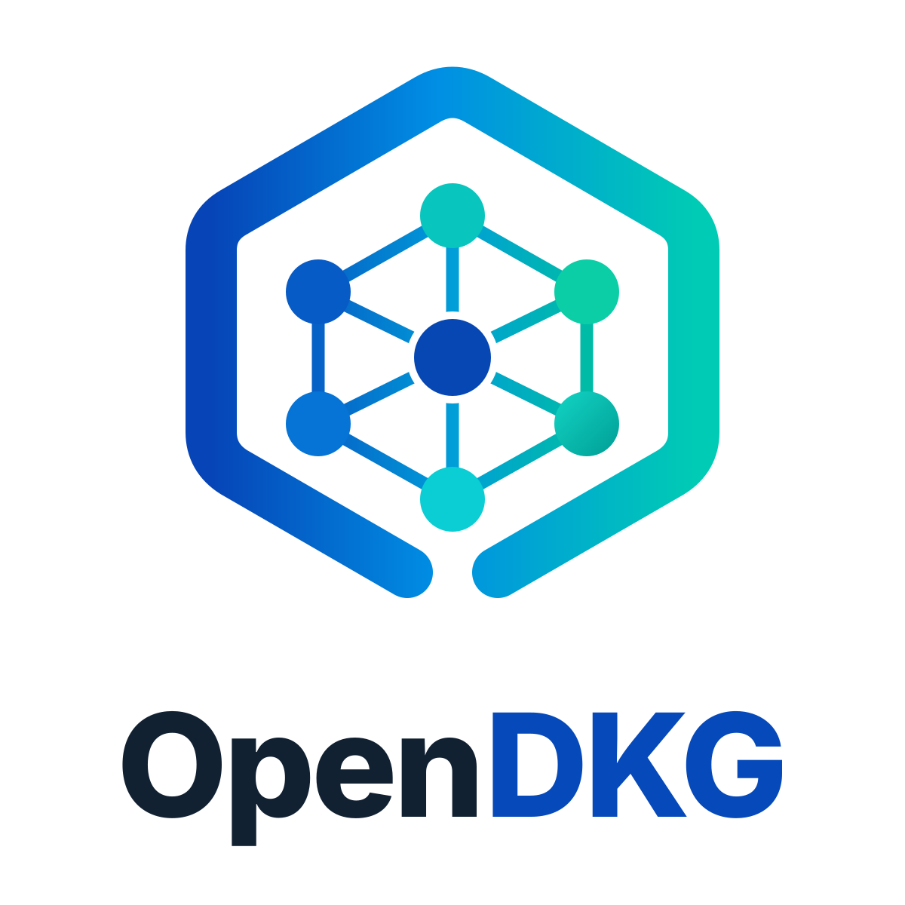

  

<h1 align="center">OpenDKG</h1>

  Independent open-source software for privacy, security, and interoperable infrastructure.

OpenDKG brings together contributors building practical, transparent, auditable tools. Our projects may integrate decentralized knowledge graph and agent-security technologies where useful, while remaining independently governed.

### Projects

- **[NetPetra](https://github.com/a-51-50/Netpetra)** — desktop network monitoring and firewall software (maintained in its own repository).
- More projects and integrations are in development.

### Participate

Read the [contribution guidelines](https://github.com/OpenDKG/.github/blob/main/CONTRIBUTING.md), [governance](https://github.com/OpenDKG/.github/blob/main/GOVERNANCE.md), and [membership information](https://github.com/OpenDKG/.github/blob/main/MEMBERSHIP.md) before contributing.

OpenDKG is independent and does not imply affiliation with, sponsorship by, or endorsement from third-party technologies it may integrate.
