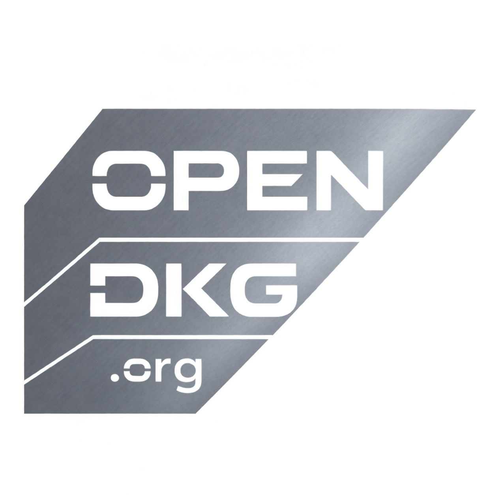

  

  <strong>Local-first, open-source software for AI-agent security, verifiable knowledge graphs, and safer everyday tools.</strong>

  <a href="https://opendkg.org/">opendkg.org</a> ·
  <a href="https://opendkg.org/apps/">Apps Directory</a> ·
  <a href="https://github.com/OpenDKG/Websites">Websites Repo</a> ·
  <a href="https://opendkg.org/transparency/">Transparency</a> ·
  <a href="https://opendkg.org/donate/">Donate</a>

---

**OpenDKG** is an independent open-source initiative building practical, local-first applications, developer gateways, assurance tools, and community bots. Everything starts on your own machine (`127.0.0.1`) with zero mandatory cloud accounts, zero subscriptions, and zero telemetry.

Where genuinely useful, projects optionally integrate verifiable **OriginTrail DKG** memory or **Umanitek Agent Blackbox** guardrails — while keeping core workflows functional offline and under user control.

## Projects

Independent project repositories keep their own release schedules, licenses, and maintainer boundaries. Browse all projects and platform availability in the [**OpenDKG Apps Directory**](https://opendkg.org/apps/).

| Project | Focus | Platforms | Status | Links |
| --- | --- | --- | --- | --- |
| **Axiom** | Agent-first endpoint security, local firewall rules, Privacy Shield DNS, and optional Blackbox/DKG guardrails | Windows x64, macOS & Linux *(previews)* | Active development *(not audited)* | [Site](https://opendkg.org/axiom/) · [Releases](https://github.com/OpenDKG/Axiom/releases/latest) · [Source](https://github.com/OpenDKG/Axiom) |
| **OpenDKG Desktop** | Local-first AI gateway (`127.0.0.1:4820`), shared 3-layer agent memory, Privacy Shield, Spend Guard, and self-custody OT-RFC-27 hub | Windows, macOS, Linux | `v0.5.0` · Active development | [Site](https://opendkg.org/desktop/) |
| **DKG Graph Local** | Zero-gas neuro-symbolic knowledge vault powered by OriginTrail DKG `v10.1.2` Working Memory, WASM Graph Computer, Privacy Split proofs, and MCP `:3847` | Windows x64 *(macOS & Linux planned)* | `v0.5.0-pre` · Active development | [Site](https://opendkg.org/graph/) |
| **VerityTrail** | Local-first security assurance lab with SHA-256 snapshots, CWE SAST & CycloneDX 1.5 SBOMs, isolated WSL2/VM checks, and read-only Blackbox-guarded AI audits | Windows x64 | `RC 0.1.0` · Active development | [Site](https://opendkg.org/veritytrail/) |
| **DKG Swarm** | Shared memory of cited findings for MCP-compatible AI assistants built on OriginTrail | Web / MCP | Live | [Site](https://dkgswarm.com/) · [Source](https://github.com/OpenDKG/dkgswarm) |
| **TRACaBot** | Evidence-first anti-scam and impersonation moderation for Telegram groups | Telegram | Live | [Site](https://tracabot.com/) |

## Principles

- **Local-first by default:** Data, vaults, keys, and local proxies stay on `127.0.0.1` unless you explicitly opt in to external publishing or cloud routing.
- **Verifiable over assumed:** Deterministic checks, SHA-256 evidence digests, and explicit separation between OS enforcement, sandbox runs, and hook guardrails.
- **Optional integrations, zero lock-in:** OriginTrail DKG and Umanitek Agent Blackbox add shared intelligence when enabled, without breaking local offline operation.
- **Zero cookies & zero telemetry:** OpenDKG websites and core local apps set no tracking cookies and collect no analytics.

## Contribute & Support

- Read our [contribution guidelines](https://github.com/OpenDKG/.github/blob/main/CONTRIBUTING.md), [governance](https://github.com/OpenDKG/.github/blob/main/GOVERNANCE.md), and [membership process](https://github.com/OpenDKG/.github/blob/main/MEMBERSHIP.md).
- Review how we document claims, status labels, and boundaries on [opendkg.org/transparency](https://opendkg.org/transparency/).
- Support OpenDKG open-source development with ETH on Ethereum mainnet via [opendkg.org/donate](https://opendkg.org/donate/).

OpenDKG is independent. Integration with a third-party technology does not imply affiliation, endorsement or joint ownership.
